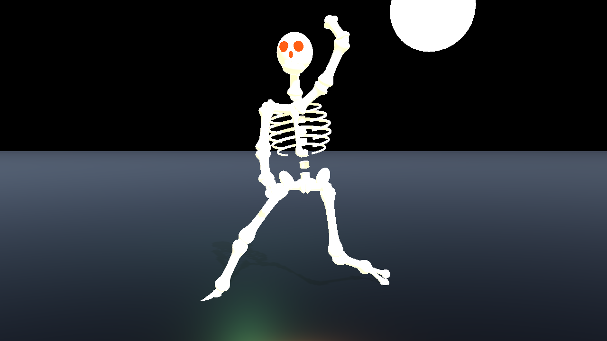
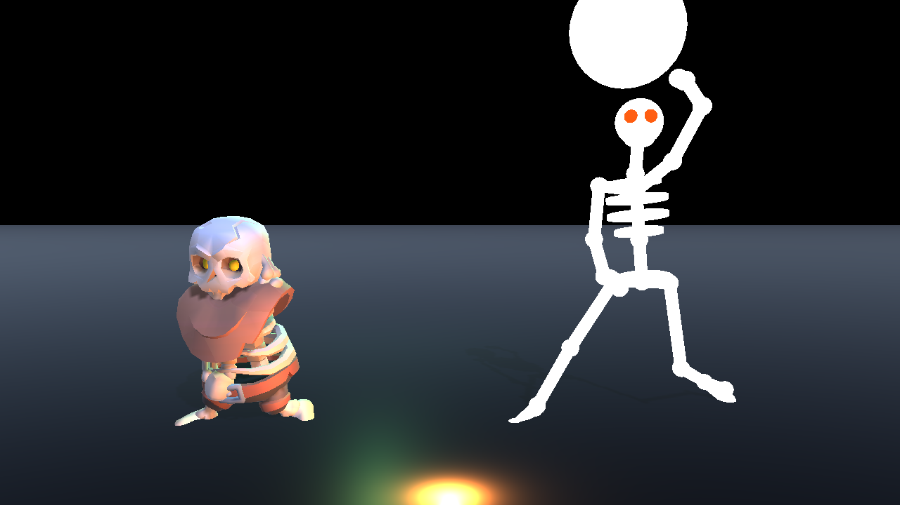
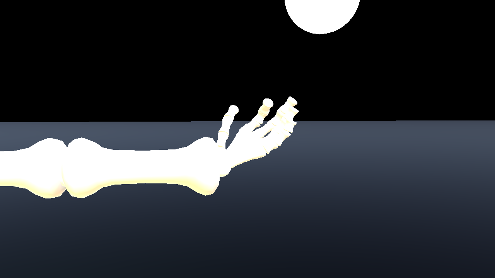
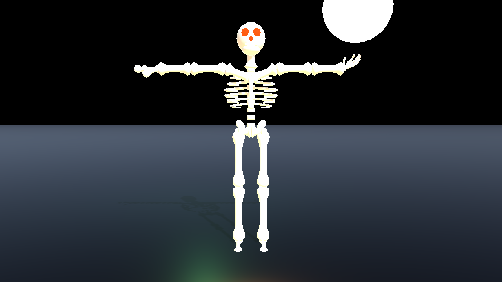
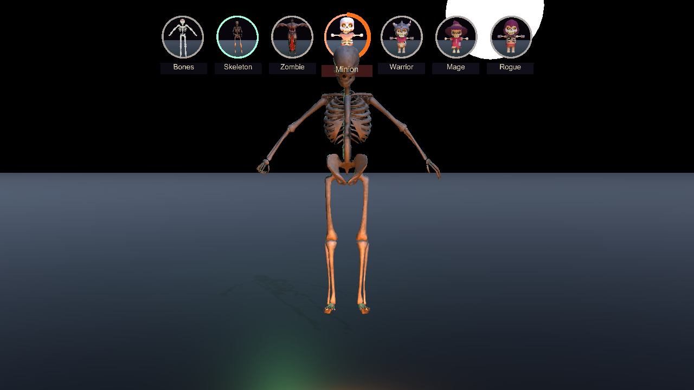
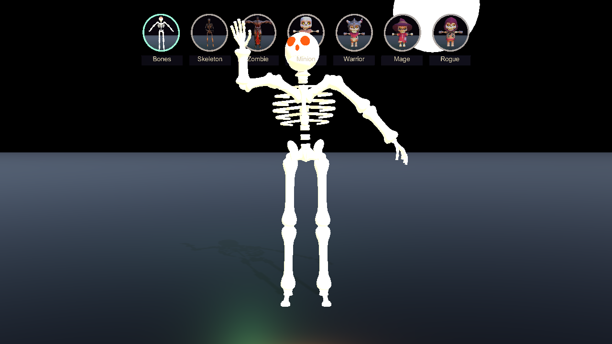
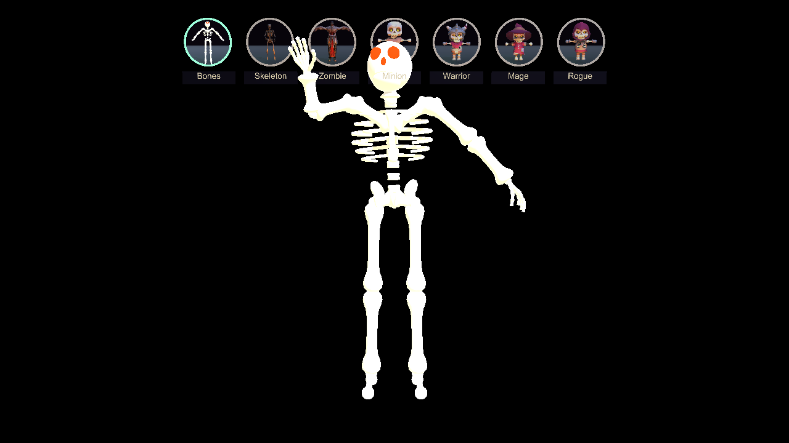

# MimicMocap

A Unity 6000.3.21f1 app that watches one person through a webcam, estimates their 3D pose in real time, and projects a glowing skeleton (or a rigged skeleton character) mirroring them. Built for a Halloween party projection.

## Getting started

1. Install Unity 6000.3.21f1 (the version in `ProjectSettings/ProjectVersion.txt`). Windows with an NVIDIA RTX GPU is what this was built and tested on; the optional [NVIDIA Maxine AR SDK](https://developer.nvidia.com/maxine) gives the best body tracking and two-person support, and without it the app uses BlazePose.
2. **Download the models before opening the project** (about 155 MB, all Apache-2.0, each checked against a SHA-256):
   ```
   powershell -ExecutionPolicy Bypass -File tools\get_models.ps1
   ```
   The models are not in the repository; their `.meta` files are, because the scene refers to them, and Unity deletes a `.meta` whose asset is missing. If you opened the project first, run the script and then **MimicMocap > Create Scene** to re-link them.
3. Open the project, then `Assets/MimicMocap/Scenes/MimicMocap.unity`, and press Play (or build with `tools
un_pipeline.ps1 -SkipTests -Build`). Optional extras (more character rigs, test videos and images) are described in `docs/TEST-MEDIA.md`.

## Quick start

- **Run it:** `Build\MimicMocap.exe`. It opens on the webcam with the NVIDIA Maxine source (falls back to BlazePose if the SDK is missing). Stand back so your whole body is in frame. `F` for fullscreen, `H` to hide the HUD.
- **Pipe a video in instead:** press `P` to switch webcam/video and `N`/`B` to step through the clips in `..\TestVideos` (any folder named `TestVideos` next to the project or the exe, or `-videoDir <folder>`). Or launch with a file:
  ```
  Build\MimicMocap.exe -video "..\TestVideos\bye bye bye - Trainer.mp4" -source maxine
  ```
  Other flags: `-source blaze|maxine|vmc|auto`, `-vmcport <udp port>`, `-webcam <index>`, `-camera <name part>`, `-rotate 0|90|180|270`, `-people 1|2`, `-mirror 0|1`, `-visual skeleton|character|both`, `-character <name|bones>`, `-ghost` / `-stage`, `-noidle`, `-nojump`, `-nofallback`, `-fill <0..0.98>`, `-bodyWidth <px>`, `-nohud`, `-nomenu` / `-menu`.
- **Sidewalk install:** `Build\MimicMocap.exe -nohud -mirror 1` gives a black stage (for a projector or a Pepper's ghost sheet) with the figure and the attract loop and nothing else; the black stage and the hidden portals are the defaults (`-stage` brings the moonlit graveyard back, `-menu` starts with the portals showing). When nobody has been in front of the camera for half a minute (`idleDelay`, 30 s, so a passer-by's brief exits never flash it) a skeleton stands there breathing, swaying and waving every ten seconds; the moment someone is tracked it becomes their mirror. Aim the camera so people stand 2 to 3 m away (hands are then 80 to 120 px tall at 1080p, which the finger tracker likes); for a 4K camera add `-bodyWidth 1280` so the body model runs on a downscaled frame while finger crops still use the full one. **Mount the camera on its side.** External cameras default to a 90 degree rotation (`externalCameraRotation`), the integrated one to none; press `O` until the thumbnail is upright and that rotation is remembered for that camera by name across launches (`-rotate <deg>` overrides for one run). A portrait frame gives a standing body the sensor's 1920 pixels instead of 1080, so hands come out almost twice as large and the person fills the frame. The app starts on the install camera, an Arducam B0590 day/night camera (`preferredCameras`, a comma-separated list of name parts, default `arducam`), else on the first physical external camera, else the integrated one; virtual cameras (Elgato Virtual Camera, OBS, NVIDIA Broadcast) only relay another app's picture and are never chosen unless named (`-camera <name part>` picks any camera by name; `-webcam <index>` forces an index). The Arducam switches to its infrared mode in the dark and, lit by an IR emitter, delivers a near-greyscale picture: both pose models and the hand landmarker take it as-is (they are fed RGB and simply get R = G = B), so nothing in the pipeline changes with the light.
- **Let XR Animator do the tracking:** start [XR Animator](https://github.com/ButzYung/SystemAnimatorOnline), turn on its VMC protocol sender (Settings > VMC protocol > Send, target `127.0.0.1`, port `39539`), then run `Build\MimicMocap.exe -source vmc` or press `S` until the HUD says `VMC receiver`. Its body, finger and head data drive the same skeleton and characters; the in-app hand tracker steps aside. Any other VMC sender (VSeeFace, TDPT, Warudo) works the same way.
- **Switch characters with your hands:** press `U` and a row of glowing portals floats above the avatar's head (they are hidden by default so the projection shows only the figure). Hold your hand inside one for about a second to become what it shows (the bare bones or any rigged character). `Tab` cycles characters from the keyboard at any time.
- **Two people:** press `T` (or launch with `-people 2`). This needs the Maxine source, whose multi-person tracker follows both people from the one webcam; each gets their own avatar standing where they stand, and each can reach up to a portal to pick their own look. Hands still work for both. BlazePose and the VMC receiver are single-person, so `T` switches to Maxine when it is installed.
- **In the editor:** open `Assets/MimicMocap/Scenes/MimicMocap.unity` and press Play. The Unity MCP bridge works once the editor is open in the foreground.

The NVIDIA AR SDK runtime is installed at `C:\Program Files\NVIDIA Corporation\NVIDIA AR SDK` (installer kept in `..\tools\`). The prebuilt NVIDIA sample `..\tools\BodyTrackSample\BodyTrack.exe` can process a clip on its own with `--offline_mode --in=<mp4> --out=<mp4> --model_path="C:\Program Files\NVIDIA Corporation\NVIDIA AR SDK\models"`.

## Hotkeys

| Key | Action |
|---|---|
| `H` | Toggle HUD |
| `M` | Mirror on/off (on = magic-mirror behaviour) |
| `1` / `2` / `3` | Skeleton / Character / Both |
| `Tab` / `Shift+Tab` | Next / previous character (or hold a hand in a portal above the avatar) |
| `U` | Show / hide the hand menu portals (hidden at start) |
| `T` | One / two performers (two needs Maxine) |
| `Y` | Steady hands (anatomical hand model) on/off, for a live before/after |
| `X` | Ghost stage on/off: pure black (the default) or the moonlit graveyard with ground, moon, fog and grain |
| `-` / `=` | Zoom out / in (the figure fills 2% less or more of the view height; hold to repeat) |
| Arrows | Move the figure on screen, 5 cm a step (hold to repeat) |
| `0` | Reset the framing |
| `I` | Attract loop on/off (idle skeleton when nobody is tracked) |
| `S` | Cycle pose source: BlazePose -> Maxine -> VMC receiver |
| `G` | Toggle finger tracking |
| `K` | Hand fallback (second hand model for hands MediaPipe loses) on/off, for a live before/after |
| `V` | Cycle BlazePose model: Lite / Full / Heavy |
| `C` | Next webcam (starts on the Arducam when it is plugged in, else the first physical external camera) |
| `O` | Rotate the camera image 90 degrees (for a camera mounted on its side) |
| `P` | Toggle webcam / test video |
| `N` / `B` | Next / previous test video |
| `R` | Reset tracking (Maxine's home depth, VMC travel origin) |
| `[` / `]` | Less / more smoothing |
| `F` | Fullscreen |
| `Esc` | Quit |

## Pipeline

```
IFrameSource  (Webcam | VideoFile | StillImage)
   -> IPoseSource  (MaxinePoseSource | BlazePoseSource | VmcPoseSource)   -> PoseFrame (34 canonical joints + 2 hands, metres, hip-centred)
   -> PoseSmoother (One-Euro per joint, confidence gating, holds through brief dropouts)
   -> ProceduralSkeletonView (glowing bones) and/or HumanoidRetargeter (the active CharacterSlot's Humanoid rig)
   -> HandMenu (world-space portals pressed by the avatar's hands) switches skeleton <-> characters
```

Canonical frame: +X = subject's right, +Y up, +Z toward the camera. The scene camera sits at +Z looking back, so the character faces the audience. Mirror mode swaps left/right and negates X.

Body smoothing is a One-Euro filter per joint in metres (1.5 Hz floor, speed coefficient 1) plus 33 ms of velocity prediction on the joints, with root travel on a calmer copy, speed-limited and not predicted. It is tuned for a mirror: on the install footage (`HandFootageTests`, lag measured to a tenth of a frame) the earlier 1.0 Hz / 0.5 setting trailed the raw wrist by 83 ms (26 mm on average) at 2.8 mm of roughness against 9.2 mm raw; the current one trails by 22 ms (13 mm) at 4.7 mm. The heavier filter was only needed while one-frame glitches had to be smoothed away, and those are now caught directly (non-finite values, the depth speed limit, foot spikes, the smoothed leg-length scale). The pipeline also lost a render frame: the director submits the new camera frame before collecting, and Maxine waits for that frame's GPU readback instead of picking it up on the next Update (`MaxinePoseSource.SynchronousReadback`), so the pose shown, and the hand crops cut from the same picture, are for the newest frame, about 17 ms sooner at 60 fps. With the lighter filter one more glitch came through: legs hidden by another person collapsed for a frame and, the figure being stood on its feet, the whole body dropped 0.7 m. The pelvis height above the feet is now speed-limited too (`maxHipSpeed`, 2.5 m/s, faster than a deep squat; `PoseFrame.HipHeight`), so such a frame dips the feet instead. The trade-off shows on poor input: on the small, fast dance clip in `StabilityTests` (raw wrist roughness 115 mm) the smoothed wrist is now 58 mm rough against 30 mm with the old setting. `[` and `]` change the filter's floor live if a venue's picture is that noisy.

### Pose sources

- **BlazePose** (`Scripts/Sources/BlazePose`): MediaPipe BlazePose GHUM via `com.unity.ai.inference` 2.6.1. Detector at 224 px only when tracking is lost; landmarker at 256 px every frame on an ROI from the previous frame's auxiliary landmarks. 3D comes from the model's metric world-landmark output. Models are Apache-2.0 from `huggingface.co/unity/inference-engine-blaze-pose`.
- **Maxine** (`Scripts/Sources/Maxine`): NVIDIA Maxine AR SDK `BodyPoseEstimation` through P/Invoke. 34 keypoints in 3D (camera space, mm) plus per-joint rotations, about 4 ms per frame on the RTX 4080. Frames are read back from the GPU asynchronously and converted RGBA to BGR by the SDK. Loads `nvARPose.dll` from `%NV_AR_SDK_PATH%` or Program Files; reports unavailable otherwise and the director falls back to BlazePose. Depth travel is measured from where the person first stood (`R` resets). Bindings follow the MIT headers in `github.com/NVIDIA-Maxine/Maxine-AR-SDK`.

  **Two people.** With `MaxPeople` above 1 the source asks for the SDK's multi-person tracker (`TrackPeople` on, batch 8, temporal smoothing off, `TrackingBoundingBoxes` with ids) and the 0.8.7 redistributable accepts it: both people in a frame come back in about 9 ms, after a one-time 2.5 s engine warm-up. People are exposed through stable slots (`IMultiPersonSource`): the tracker's ids are used once they exist (they are all 0 for the first ten frames of probation), people are otherwise matched to the slot whose last box is nearest, and newcomers fill free slots leftmost first. Slot 0 is what `TryGetLatest` returns, so single-performer code never notices. The default `MaxPeople = 1` path is byte-for-byte the previous single-person behaviour.
- **VMC receiver** (`Scripts/Sources/Vmc`): listens for the [VMC protocol](https://protocol.vmc.info/english.html) (OSC over UDP, port 39539 by default) that VTuber trackers such as XR Animator, VSeeFace, TDPT and Warudo send. `OscPacket` decodes bundles without allocating; `VmcPoseSource` stores each `/VMC/Ext/Bone/Pos` (Unity `HumanBodyBones` name, local position, local rotation) and `/VMC/Ext/Root/Pos`, then runs forward kinematics down the humanoid hierarchy to place the canonical joints, synthesises ears/eyes/nose from the Head bone so the face-based head aim works, builds the 21-landmark hands from the finger bones (tips extrapolated from the distal phalanx), and reports the hips' travel in `RootOffset`. Bones the sender's avatar lacks (UpperChest, Toes) chain through their nearest ancestor; rotation-only senders get default proportions. The webcam frame is ignored while this source is active and the in-app hand tracker is bypassed, since the sender delivers fingers too. Why bother: XR Animator's MediaPipe Holistic pipeline tracked hands better in the user's test than our in-process crops, and the receiver is 100% source-agnostic, so any future tracker that speaks VMC plugs in with no code.

### Hands

`Scripts/Sources/BlazeHand/HandTracker.cs` runs MediaPipe's hand landmarker (21 points with depth, Apache-2.0, from `huggingface.co/unity/inference-engine-blaze-hand`) on a rotated square crop per hand, both hands every frame, no palm detector. Once a hand is found, the next crop comes from that hand's own landmarks (MediaPipe's tracking mode, with a lower keep threshold and a few frames of grace); when it's lost, the crop is placed from the body: wrist required, finger direction from the knuckles, else the forearm, else the last known direction, so hands keep working when your elbows are out of frame. Results are wrist-relative and ride along in `PoseFrame.LeftHand/RightHand`; the skeleton view swaps its wrist fork for the 20 hand bones when a hand is present, and `HumanoidRetargeter` drives Mecanim finger bones on any rig that has them (Mixamo rigs do). `G` toggles hands, `R` resets tracking. Both hands cost roughly 1 to 2 ms on the RTX 4080 once warm.

Re-acquiring a lost hand is where one hand used to come back at once while the other never did: the body's guess at the finger direction (knuckles, else forearm) was the only rotation tried, and a wrist bent the other way left the landmarker looking at a sideways hand. A lost hand is now searched with up to three crops at different rotations (knuckle direction, forearm direction, last known, upright) in the same frame, and the first one the landmarker accepts wins; a tracked hand still costs one run. The three crops are: the tight crop shifted along the best direction guess (the most accurate when the guess is right, and small hands need every pixel), a 30% wider crop centred on the wrist with the same rotation (a hand whose fingers point somewhere else entirely sits outside a shifted crop, so this catches it at lower resolution and the tracked crop tightens the next frame), and the tight crop along the next best direction. A hand that has never been seen borrows the other hand's remembered size, since both hands are the same size. Entry thresholds are 0.35 (0.25 for small crops), keep 0.25, with eight misses of grace. The HUD's hand line explains a missing hand instead of just showing a dash: `L presence 0.21 (forearm)/96px` means every crop was tried and the best presence was 0.21, `too small 37px` means the hand is too far away, `gate` means the hand found was not at this body's wrist, `no wrist` means the body pose had no confident wrist.

#### Measured on the install camera

`TestVideos/TestHands.mp4` is a 51 s clip from the Arducam of a person raising, turning and waving their hands, walking out of frame, coming back further away and doing more hand motions, in a dim lit room (not infrared). `HandFootageTests` runs it through the real scene with Maxine and writes `Logs/PoseCheck/testhands_report.txt` (detection rate per hand, a reasons histogram, a per-second timeline, fingertip jitter and lag against the raw detections), a per-frame CSV, an annotated contact sheet and, when `k_CaptureCrops` is on, the crops the landmarker rejected. Three findings from it, each fixed and re-measured:

- Once a hand had been missed, the next crops kept the finger direction of the last detection for eight passes before the body was consulted. On miss frames that direction sat 50 to 120 degrees off the body's own knuckle direction (8 degrees on hits), so the crops were rotated and centred up the forearm with the hand at the edge. Miss frames now take the body's knuckle (else forearm) direction at once, and also try a wide body-placed crop in the same pass. Detection on the clip went from 64% / 63% of tracked frames (left / right) to 86% / 81%.
- The hand pass waited for its GPU readback before the next frame could be submitted, which held the fingers to about 19 updates a second against the body's 30. Passes are now pipelined (`HandTracker.MaxInFlight`, default 2, each pass with its own workers and input tensors), so a pass starts on every tracked frame.
- Brightening the clip changed nothing (81% / 75% against 80% / 75%), so the dim picture is not what limits the landmarker here; a quicker finger filter profile (3 Hz, beta 0.01) added jitter without reducing the one-frame lag, so the filters stay as they are. What remains is the far segment, where hands of about 60 pixels are at the landmarker's limit: stand within 3 m.

The same harness also measures what the audience sees against what the camera saw: the index tip of the stabilised hand against the raw detection, wrist-relative, on frames with a fresh detection. It started at 40 mm apart on average, a quarter of a hand. Fitting each detection with the anatomical model and rebuilding it with no filtering still left 22 mm at the tip, because the template's fingers were 25 to 30% longer than this person's as MediaPipe measures them. The stabiliser now learns each hand's knuckle positions and segment lengths from its detections (the first one is adopted, later ones at 5%, within bounds), which brought the unfiltered residual to 12 mm at the tip and 7 mm per landmark. The rest was the palm filter: the fingertips ride on the palm orientation, and 1.4 Hz was three frames of lag during a wave. Finger filter speed made no difference (quicker profiles only added jitter). Palm 3 Hz / beta 0.5 brought the shown error to 26 mm but let synthetic 4 mm noise through at 3.2 mm, breaking the stabiliser's three-times promise; 2 Hz / beta 0.3 is the new default at 28 mm, with the shown jitter on the footage at 9.5 mm against 18 mm raw (7.8 mm before). Static error with full trust is now about 16 mm; fast motion about 40 mm, down from 45.

Two night takes with the camera in its infrared mode followed (`TestVideos/Night.mp4`, well exposed, and `NightBright.mp4`, with the IR emitter too close): standing gestures, then walking in and out of frame while waving. Record them with `tools/record_camera.ps1`, which now bakes the camera's quarter turn into the clip so it plays upright. Findings:

- The body locks on within a frame of Maxine seeing enough of the person (score 0.8 to 0.9 on the first tracked frame), and the first hand is detected 0 to 9 frames later, so a passer-by is picked up as soon as they are properly in frame. The gaps are the two to three seconds while a walker is only half in frame at the edge or right in front of the lens, where no body tracker fires.
- While standing, hands are found in 85% to 90% of frames on the well exposed night clip (73% / 71% over the whole clip, 76% / 72% after the colour fix below); while walking by, 30% to 60%. The rejected crops show motion blur (the night exposure is long) and hands leaving the frame, which no crop placement recovers. The arm still waves on the skeleton through those misses because the stabiliser's body-driven hand follows the wrist.
- With the emitter too close, skin and shirt saturate to pure white and the fingers have no texture; detection drops to 68% / 50% standing and lower walking. Move the emitter back or off the camera axis, or diffuse it; software cannot restore a clipped hand.
- The crop sampler applied a linear-to-sRGB curve to pixels that were already sRGB (this project renders in Gamma colour space; the shader came from Unity's sample, whose project is Linear), lifting midtones by a quarter and pushing the bright infrared picture toward white. `BlazeUtils.SampleImageAffine` now encodes only in a Linear colour space project. It is the right thing to feed the models and measured a small gain on the night clip; the dim clips were unaffected.

#### Steady hands

Raw detections are not what gets drawn. `Scripts/Core/HandStabilizer.cs` fits every detection to an anatomical hand model with about twenty degrees of freedom (palm orientation, hand size, and per finger a spread angle plus three bend angles with hard joint limits: MCP -15..95, PIP -8..115, DIP -8..90 degrees, thumb CMC/MCP/IP with their own ranges), smooths those angles with One-Euro filters tuned for degrees, and rebuilds the 21 landmarks from the smoothed model. Noise that does not fit a real hand cannot get through, which is the same idea VTuber solvers such as Kalidokit use. When the detector loses a hand (too small, fingers pointed at the camera, out of frame) nothing snaps: the palm keeps following the body's own wrist and knuckle joints (Maxine and BlazePose both provide them), the fingers relax toward a natural half-curl over `relaxSeconds`, and the hand stays drawn with the detector weight shown on the HUD as `steady L 1.00 R 0.35`. When detection returns it eases back on over `reacquireSeconds`. The crop placement also has a dead zone now, because the landmarker's output shifts a little with every crop change. `Y` toggles the stabiliser for a live before/after. Measured on synthetic noise of 4 mm per axis, fingertip jitter drops by more than 3x with no bias, and a two-second dropout never moves a landmark more than 12 mm in one frame.

Three more things borrowed from how MediaPipe Holistic and XR Animator behave: the tracked crop uses Holistic's `RoiTrackingCalculator` rule (adapted under Apache-2.0), keeping the previous crop until the hand moved by 20% of it, changed size by 40%, turned 40 degrees, or a landmark left the crop shrunk by 10%, because the landmarker's output shifts a little with every crop change; a detection whose wrist is not within 40% of the crop of the body's wrist is rejected as someone else's hand; and small crops (under 100 px) use a lower entry threshold, the way XR Animator switches to a 0.1-confidence landmarker for far users.

#### Smoothing adapted from MediaPipe

Three calculators from the MediaPipe framework are reimplemented in `Scripts/Core` (credited in `NOTICE`): the **scale-normalised One-Euro** (`ScaledOneEuroFilter2`, from `landmarks_smoothing_calculator`), which divides values by the person's size in the frame before filtering so one setting behaves the same at 2 m and 4 m; the **visibility low-pass** (`confidenceAlpha`, from `visibility_smoothing_calculator`), which gates joints on a smoothed confidence so a single bad frame cannot blink a limb; and the **auxiliary-landmark ROI smoothing** (0.01 Hz / beta 10 in ROI units, from `pose_landmark_filtering.pbtxt`), applied to BlazePose's tracking crop so the crop, and with it every landmark, stops creeping while a person stands still. The image-space joints that place the hand crops and HUD dots go through the image-landmark profile (0.05 / 80). The hand stabiliser now runs on the smoothed body, so its body-driven palm inherits all of this.

#### Hand fallback (RTMPose)

When every MediaPipe crop misses a hand, a second hand model, MMPose's RTMPose-m hand5 (Apache-2.0, 21 points in 2D), runs on the same first-choice crop, straight from MediaPipe's input tensor on the GPU (resized from 224 to 256 inside its graph), so it costs one extra GPU round trip on missed hands only. Its result is used when it is confident (`FallbackThreshold` 0.35) and its wrist sits at the body's wrist; its 2D points are lifted to 3D with the hand's last MediaPipe scale and depths and go through the steady-hands model like any detection. It finds the hands MediaPipe drops mid-wave (motion blur), hanging at the sides and at the frame edge: on `TestHands.mp4` hands go from 86% / 85% of tracked frames to 91% / 90%, on the infrared `Night.mp4` from 75% / 74% to 78% / 81%, with fingertip jitter 5.7 to 6.4 mm and 8.3 to 9.2 mm. A recovered hand's finger bends in depth come from its last MediaPipe detection, so waves and spread fingers carry over better than fingers pointed at the camera. On by default; `K` toggles it live and the HUD shows `fallback <hands supplied>`; `-nofallback` turns it off. The model is downloaded with the others by `tools/get_models.ps1` (`Assets/MimicMocap/Models/RTMPose/rtmpose_m_hand5.onnx`, the `end2end.onnx` of OpenMMLab's ONNX SDK package); without it the app runs MediaPipe alone. The spike that led here, including the RTMW3D whole-body model that was accurate but too slow (20 poses a second), is in `docs/research/2026-10-20-dropout-and-models-research.md`.

#### A limb the tracker loses

Maxine does not say when it has lost a hand: on the install footage its wrist confidence was above the threshold on every tracked frame, even with the hands out of frame, and when a raised hand left the top of the picture (or went behind the head) it confidently put the wrist at the side, so the arm dropped there in one frame. `PoseSmoother` now judges each joint by plausibility rather than confidence. A joint is not trusted while its source position is further from where it is shown than a person could move in that time (`handMaxSpeed` 9 m/s for hand joints, about a fast wave or punch; `jointMaxSpeed` 6 m/s for the rest), or while the source puts it on the picture's edge. An untrusted joint stays exactly where it was for `jointHoldSeconds` (0.4 s), then eases toward the source's guess at `jointRelaxSpeed` (0.5 m/s, so a raised arm that really went down while out of view comes down over about two seconds); once the source is back within reach (the hand re-entered the frame) it catches up at `jointCatchUpSpeed` (4 m/s; 2 m/s throttled fast dancing to 150 ms of lag on the noisy dance clip) and is trusted again within 6 cm, so trust never returns with a jump. On top of that, no joint drawn moves faster than those speeds whatever the source does. `JointTrustTests` plays out the raised hand leaving the frame, coming back, a brisk 2.5 Hz wave (always trusted), a hand on the picture's edge and a whole-pose glitch. Side effect on noisy input: the dance clip in `StabilityTests` went from 58 to 28 mm of wrist roughness (raw 115), because its noise spikes are now rejected as implausible.

#### Through a dropout

The body tracker drops the person for a frame now and then (the install clips have three or four one-to-three-frame gaps a minute between the real walk-outs, more on the night takes), and every such gap used to reset the smoother. The next frame then came out raw: joints that had been held at their last good position (an occluded wrist, say) jumped to their raw garbage positions, every joint showed its unfiltered jitter until the filters had settled again, and the floor tracker forgot a jump in progress; on the skeleton that read as a twitch of the whole figure. `PoseSmoother` now holds through a loss shorter than `holdSeconds` (0.5 s): the last smoothed pose stays on screen, carried along its low-passed velocity with a decaying time constant (`extrapolateSeconds`, 0.08 s: a wave keeps waving for a few frames and slows to a stop, and the carried distance is bounded by the velocity times 0.08 s, so even a fast hand drifts a few centimetres at most), with its confidences and last-good memory intact and the HUD saying `HOLDING`. When tracking returns, the One-Euro filters are primed with what was shown a frame ago, so the pose eases onto the new detection over a few frames instead of snapping to it (MediaPipe's own filter takes the whole gap as its `dt` and snaps; none of the VTuber apps surveyed extrapolate, they hold for 200 to 250 ms; see `docs/research/2026-10-20-dropout-and-models-research.md`). A loss longer than the hold still resets, so the next person starts from their own pose, and the performer handoff is unchanged. `PoseHoldTests` pins this on synthetic motion: a held frame never moves faster than the pose was moving, reacquiring never steps more than 2.5x a normal frame and settles back to the usual lag within half a second, an occluded joint stays put across the gap, and a one-second loss expires the hold. On `TestHands.mp4` the three one-frame gaps are now held; the largest smoothed-wrist step within ten frames of a gap is 62 mm against 213 mm with the hold off (typical step 9.6 mm), and those 62 mm are the person walking out of frame, not a snap. The infrared night take, whose dropouts fall mid-gesture, goes from 361 mm to 78 mm (typical step 17 mm) with hands and body jitter unchanged; freezing the pose instead of carrying its velocity leaves 114 mm, and a longer carry (0.15 s) gains nothing over 0.08 s, so the short one stays. `predictSeconds` (Kinect-style lag compensation) is there too but off: 33 ms of prediction raised the smoothed wrist roughness from 2.8 to 3.7 mm and took no measurable lag off at the 33 ms resolution of the measure.

#### Experiments on the install footage

`HandFootageTests` reads a few environment variables so a change can be measured on the same clip without touching code: `MIMIC_BODY_PROFILE` (`minCutoff,beta[,holdSeconds,extrapolateSeconds,predictSeconds]`), `MIMIC_BODY_WIDTH` (downscale the frame the body source sees), `MIMIC_HAND_THRESHOLDS` (`keep[,entry[,far]]`, the landmarker's presence thresholds), `MIMIC_SOURCE` (`blaze|maxine`), `MIMIC_FINGER_PROFILE`, `MIMIC_TEST_CLIP`, and `MIMIC_RUN_TAG` to keep one run's outputs apart from another's; `tools\run_footage.ps1 -Tag w540 -Vars @{ MIMIC_BODY_WIDTH = '540' }` runs one such experiment (about 72 s) and prints its report. Measured on 2026-10-20 (hand detection left / right of tracked frames, fingertip shown jitter, body wrist roughness smoothed and raw):

| Run | Hands | Fingertip jitter | Wrist roughness |
|---|---|---|---|
| Maxine, full 1080 px frame (shipped) | 86% / 85% | 5.7 mm | 2.8 mm (raw 9.2) |
| Maxine on a 540 px frame | 86% / 82% | 10.6 mm | 3.0 mm (raw 9.1) |
| Maxine, 33 ms prediction | 86% / 84% | 5.8 mm | 3.7 mm (raw 9.3) |
| Maxine, hand keep threshold 0.15 (XR Animator's far mode) | 87% / 85% | 5.7 mm | 2.9 mm (raw 9.2) |
| BlazePose Full, full frame | 85% / 82% | 10.7 mm | 3.5 mm (raw 15.0) |

Three things fall out. Lowering the landmarker's keep threshold from 0.25 to 0.15 changes nothing beyond the run-to-run noise of about three points, so the thresholds stay. Halving the body frame leaves the body about as steady but doubles the fingertip jitter and loses hand detections: the hand crops are placed from the body's image joints, coarser joints move the crops about, and the landmarker turns every crop shift into a landmark shift, so the body stays on the full frame (and cropping the frame around the person would help only a landscape camera; the portrait install camera already has the person filling it). BlazePose's raw wrist is 60% rougher than Maxine's and its wrist confidence drops out on 4% of frames, so Maxine stays the install source with BlazePose the fallback. A different model altogether is the next step up: the research notes rate RTMW3D (133 keypoints with depth, Apache-2.0, ONNX) and RTMPose-m hand5 as the two worth a day's spike.

Resolution matters: the landmarker wants a hand of at least ~60 px in the source frame. With a 720p webcam that means standing within about 1.5 m; further back, the fork comes back automatically.

Foreshortening (fingers pointing at the camera) collapses the visible hand, so the tracker remembers each hand's largest recent extent and never crops smaller than 1.5x that or the body's forearm-based estimate, freezes the crop rotation while the wrist-to-knuckle vector is too short to trust, and centres on the landmark centroid rather than assuming the fingers extend in the image plane. That remembered extent used to shrink only on a successful detection, and it floors the crop size, so a person who walked up close, left, and came back further away was locked out: every crop was sized for the big hand, the landmarker saw a hand too small to accept, and nothing could refresh the memory (`HandReacquireTests` reproduces it with the reference hand at full size and then at 30 to 40%: 0 of 15 frames reacquired against 15 of 15 for a fresh tracker). The extent now fades by 7% on every frame the hand is not found, so the body's own size estimate takes over after the eight frames of occlusion grace and the returning hand is back within about a third of a second. The HUD's hand status shows presence and crop size per hand, e.g. `L 0.82/96px R 0.44/88px`.

### The skeleton

`Scripts/View/ProceduralSkeletonView.cs` builds the figure from procedural meshes in `SkeletonMeshes.cs`: knobbed long bones (a lathe profile), curved ribs (a tube along a semi-ellipse, six pairs plus a sternum), a vertebral column of eight drums, a sacrum with flared iliac wings, and a skull with eye sockets, nasal cavity, jaw and a row of teeth. Everything is positioned from the tracked joints each frame, so it needs no rig or asset and always matches the pose. Turn `anatomicalDetails` off for the plain glowing stick figure.

### Characters

`CharacterRoot` in the scene holds every rigged character, each under its own `CharacterSlot` (display name + head scale), with one active at a time. Any FBX imported as a Humanoid works: put it under `Assets/MimicMocap/Characters/`, run **MimicMocap > Setup Characters** and every Humanoid FBX found is placed, scaled to 1.75 m and dropped so its lowest mesh point sits on the floor (downloaded models often have their origin at the pelvis). `-characterFbx <asset path>` picks which one starts active. Mixamo FBX files get their embedded textures extracted; Standard-shader materials are converted to URP Lit if the importer didn't already make them; loose base-colour PNGs are attached.

MMD models (PMX) work as well: `tools/pmx_to_fbx.py` converts one with Blender and MMD Tools (and re-skins mesh that hangs off IK-only helper bones onto the real arm and neck bones, since the FBX carries no IK), and Setup Characters maps the Japanese MMD bone names (legs on the deform `D` bones, thumbs from 親指０) and fixes up the materials (two-sided, matte and partly self-lit like an MMD render, hidden-by-default parts kept hidden, hair alpha-clipped); see `docs/TEST-MEDIA.md`. Sour's Miku was added this way during development and is not in the repository (non-commercial licence).

Six ship today, in menu order: **Skeleton** (`Characters/SkeletonAnimated`, a 3ds Max Biped rig with 52 mapped bones including all fingers; Unity's auto-mapper mislabels one hand of Biped-named fingers so Setup Characters rewrites the mapping for any `*_L/R_Finger0..4` rig), **Zombie** (Mixamo `Skeletonzombie_T_Avelange`, fingers too) and the four KayKit chibi skeletons **Minion, Warrior, Mage, Rogue** (CC0, head scale 0.6 so their skulls don't hide raised arms).

Switching is instant and happens at runtime: `MocapDirector.SelectCharacter` hides the others, binds a `HumanoidRetargeter` to the new rig the first time it is shown (the rig is still in its rest pose then) and reuses it afterwards; the previous rig is returned to rest. `Tab` cycles, `-character zombie` starts on one, and the **hand menu** does it hands-free. Feet are retargeted from the sole (heel to toe, with the pelvis as up) rather than ankle to toe: rigs keep their toe bone at very different angles below the ankle (MMD 45 degrees, Mixamo 35, a tracked foot 15 to 25), and matching ankle-to-toe directions turned that difference into a permanent toe-up bend; a level sole is what every rig and every standing person agree on.

**Jumps.** Every view plants the lowest foot on the floor each frame (the hips sit at the subject's pelvis-above-feet height), and until now every source zeroed vertical travel, so a jump was cancelled: the figure stayed put while the legs tucked. Sources now report the pelvis's height in their own frame (`RootOffset.y`: camera space for Maxine, image height in metres for BlazePose, the sender's world for VMC) and `Scripts/Core/FloorTracker.cs` turns it into a lift above the floor: the floor is where the lowest foot was while grounded, followed within a fifth of a second so walking toward or away from a camera that looks down at the sidewalk never reads as a lift; a jump is recognised by its launch (the foot rises 8 cm within a tenth of a second, which walking never does), the floor freezes while airborne, and landing grounds the figure. The shown lift eases toward its target with a 40 ms time constant (`FloorTracker.EaseSeconds`): airborne is only recognised once the foot has risen 8 cm, so without the ease a small dance hop popped the whole figure up by that much in one frame and snapped it down on landing, about 10% of its height; on the two-person clip's dance hops the largest one-frame step of the lift went from 9.1 to 5.5 cm with the hop height unchanged (17.5 to 16.3 cm). Both views add the lift to the hips (`PoseFrame.Lift`); `-nojump` disables it. `figureFill` (default 0.78, `-fill`) sets the camera's field of view so a standing figure fills that fraction of the view height, with a little floor under the feet and most of the spare room above for raised arms and jumps. At runtime `-` and `=` zoom, the arrow keys move the figure on screen and `0` resets; the result is saved (PlayerPrefs) so the install keeps it across launches, and `-fill` on the command line wins for that run without being saved. `FramingTests` checks that the figure fills the asked fraction and that each key moves it the way it says.

#### Hand menu

`Scripts/App/HandMenu.cs` builds a row of round portals in world space, 1.98 m up (a raised hand reaches them; the avatar is normalised to about 1.75 m tall), one per character plus **Bones** for the procedural skeleton. Each portal shows a live-rendered preview of its character (a hidden camera renders every slot once at startup) with an ember ring that fills while a hand rests inside; after `dwellSeconds` (0.9 s) it presses, flashes, and the character swaps. The pointer is the avatar's own hand, taken from the rigged character's hand bones or the skeleton's wrists, so it works identically mirrored or not, with any pose source, and needs no screen projection. Moving to another portal re-arms immediately; holding still after a press does nothing until you leave (plus a 1.2 s cooldown), so nobody flickers between characters by accident. The portals start hidden so a projection shows only the figure; `U` toggles them, `-menu` starts with them showing, `-nomenu` keeps them off.

The default view is the procedural skeleton. Press `2` for the rigged character, `3` for both side by side.

#### Attract loop and ghost stage

`MocapDirector.idleAttract` (default on, `I` toggles, `-noidle`): when nobody has been tracked for `idleDelay` seconds the avatar is driven by a built-in idle pose that breathes, sways from the hips, turns its head and waves every ten seconds, with relaxed template hands, so the screen is never empty and passers-by can see it is a skeleton that will copy them. The skeletons (the procedural **Bones** and the rigged **Skeleton**) are drawn with `Shaders/NeonBones.shader`, a neon look: bones are near-black where they face the camera and glow deep blue toward their edges, with a hot cyan-blue fresnel rim at the silhouette, drawn opaque (bones hide what is behind them; an earlier additive version let the spine show through the skull and ribs) with the bloom pass haloing the edges against the black stage; the eye sockets are plain black so they stay dark holes. The rigged skeleton keeps its bone texture as luminance detail. Colours and rim power are material properties (`Materials/SkeletonBone.mat` and friends). `ghostStage` (default on; `X` toggles, `-stage` starts on the graveyard, `-ghost` forces black) hides the ground and moon and turns off fog, vignette and film grain so the frame is pure black apart from the figure, which is what a projector on a dark wall or a Pepper's ghost sheet needs.

#### Who the avatar follows

The tracker now runs Maxine's multi-person mode even when one performer is shown (`stableIdentity`, default on; `-people 1` still shows one avatar). Two reasons. First, identity: in the SDK's single-person mode a second person stepping into frame could take the avatar mid-performance, because the SDK picks the most prominent person every frame; with everyone tracked and the stable slots, performer 1 stays with its person while others are in view, passes to whoever is still tracked once its person has been missing for `performerSwitchDelay` (0.5 s), and does not jump back when the first person returns (`PerformerHandoffTests` plays this out on the two-person composite: handoff in 0.6 s, zero frames back on the returning person). The smoothers and hand trackers forget the previous person at a handoff so nothing blends between two bodies. Second, lag: the multi-person mode has the SDK's temporal smoothing off, which takes 33 ms off the body (wrist lag 100 to 67 ms on the install footage) for a little more raw jitter that the One-Euro filters absorb (smoothed wrist roughness 2.1 to 2.9 mm on that footage; on the fast dance clip 29 to 35 mm, with lag 67 to 50 ms). The multi-person engine costs about 9 ms a frame instead of 4 and warms up for 2.5 s at start.

#### Two performers on the install footage

`TestVideos/two people leave.mp4` (90 s from the install camera: two people gesturing, each leaving and returning, one walking up to the lens, then one dancing alone) replays through the real scene with two performers in `TwoPersonFootageTests`, which logs both performers every frame and fails on any avatar step of half a metre or more, or an avatar off the stage. It found four bugs behind a live report that an avatar "bounced off screen and only came back after I left and re-entered":

- **NaN from the SDK.** Maxine now and then returns a non-finite pelvis for a person. One NaN reaching the One-Euro filters poisoned them until the person left (the only thing that reset them), so the avatar froze or vanished. Non-finite people are now dropped at the source, non-finite keypoints get zero confidence, and the smoother never lets a non-finite value into a filter (`SmootherGuardTests`).
- **One-frame jump glitches.** The 3D estimate's feet glitched 0.7 m in 33 ms, the jump detector took it for a take-off and threw the avatar 1.3 m up for a frame. `FloorTracker` now ignores any frame whose foot moved faster than 4 m/s (a jump takes off at about 3 m/s); a change that lasts more than three frames is a new floor, not a jump (`FloorTrackerTests`).
- **Tracker ids that teleport.** The SDK's tracker re-identifies lost tracks loosely: it gave a man's id to a woman entering at the other edge, then moved it back while both were in view, so performer 1 hopped 1.4 m between two people in one frame. A slot now takes a tracker id only if the person's box is within 15% of the frame per missing frame (at most 30%) of where the slot's person was; anyone else is matched by position or takes a free slot.
- **Depth glitches and a pumping figure.** Standing still beside the couch, depth jumped 0.2 to 0.4 m between frames and the measured leg length swung 15%, and the views scale the whole figure by leg length each frame. Travel is now limited to 3 m/s (`maxTravelSpeed`; nobody walks faster) and the views use a leg length smoothed over a second (`legLengthSeconds`, `PoseFrame.LegLength`), which steadies one-person mode too.

On the clip, steps over 25 cm went from 21 to 2 and steps over 50 cm from 17 to none (a held frame also has to keep the smoothed leg length, or the scale jumps on the first frame of a dropout); what is left are two single-frame twitches of about 30 cm while one person's feet are hidden by the other or the furniture. When a performer's person is gone for the slot's 1.5 s hold, the next person to enter takes that performer (and its look); that is by design. Walking right up to the lens still brings the avatar toward the audience, as travel should.

#### Two performers

`T` or `-people 2` turns on the second performer. `MocapDirector` then reads slot 1 of the multi-person source into a second pose pipeline (its own smoother, hand tracker and hold timers) and drives a second avatar under a `Performer2` root: a second procedural skeleton, or a runtime clone of any character rig (cloned from its rest pose, with its own retargeter). Both avatars place themselves from their person's travel, so they stand on stage where the people stand in front of the camera, mirrored like everything else. Performer 2 starts as a different rig from performer 1 so the pair never match; the portals attribute a press to whichever performer's hand is inside, so each person picks their own look. Dropping back to one performer re-creates Maxine in single-person mode (temporal smoothing on again). Asking for two performers on BlazePose or the VMC receiver simply keeps one.

## What it looks like

Source frame from one of the test dance videos with BlazePose landmarks, and the scene driven from that same frame (mirror mode on):

The annotated camera frames (BlazePose and Maxine landmarks over the test videos, hand crops, contact sheets) are written to `Logs/PoseCheck/` by the tests; they are frames of other people's videos, so they are not in the repository.




A video clip driving the skeleton through the NVIDIA source, sampled every second (source frame above, render below):


Finger tracking on MediaPipe's reference hand. Pink: our landmarks from the wrist-placed crop; blue: the sample's own reference:




Hand menu: seven portals above the avatar (Bones plus six rigs), each with a live-rendered preview; the ember ring fills while a hand rests inside.



Attract loop (nobody tracked: the skeleton breathes, sways and waves) and the same moment on the ghost stage, pure black for a projector or a Pepper's ghost sheet:




## What was verified

Night 1 (no SDK, no webcam):

- EditMode tests: filters, joint layouts, mirroring, smoothing gate (7/7).
- PlayMode `BlazePoseSmokeTests`: real ONNX inference on frames from the test dance videos. 3 of 3 real-footage frames tracked at presence 1.0 with metric body sizes (torso ~0.5 m, leg ~0.7 m).
- PlayMode `SceneRenderSmokeTests`: loads the real scene, runs the full pipeline from a still frame, checks the rig's limb directions against the tracked pose (all limbs within 0.1 deg, spine 2 deg).

Night 2 (SDK installed):

- NVIDIA's own `BodyTrack.exe` processed all 790 frames of `Kung Fu Girl.mp4`; its raw 3D output confirmed the SDK convention (y down, x image-right, z away from camera, millimetres) across 753 valid frames.
- PlayMode `MaxineSmokeTests`: Maxine inside Unity tracks all 3 test frames (score 0.80 to 0.88, 3.8 to 4.5 ms) and agrees with BlazePose on limb directions to a median of 12 deg over 30 limbs. Annotated frames in `docs/images/maxine_trainer_frame.png`.
- PlayMode `VideoPipelineTests`: both clips through the real scene for both sources at 30 poses/s. BlazePose tracked 90% / 100%, Maxine 84% / 100%. Contact sheets (video above, skeleton below) in `docs/images/video_*.png`.
- The built `MimicMocap.exe` launched with `-video ... -source maxine`, loaded the SDK and tracked the clip (see `%APPDATA%\..\LocalLow\MimicMocap\Mimic Mocap\Player.log`).
- Webcam: the built player opened the Integrated Webcam at 1280x720 @ 30 fps with the SDK loaded and no errors (`Player.log`). Batch-mode editors do not stream cameras, so `WebcamSmokeTests` reports inconclusive there rather than failing.
- Still unverified: a person actually standing in front of the webcam. Everything downstream of the frame is identical to the video path, which is verified.

Later live-test fixes: the skull is now aimed from the face (ear line for the side axis, eyes for the facing, damped 70% toward the torso via `HumanoidRetargeter.HeadFollow`) instead of the shoulder-to-ear vector that made it look up and turn; each hand keeps its last good landmarks for `handHoldSeconds` (0.5 s) through brief misses instead of snapping back to the fork; hand entry threshold 0.45; the webcam is asked for 1920x1080 so hands are larger in the crops.

Day 2 fixes from live testing: the HUD thumbnail is drawn mirrored when mirror mode is on so the landmark dots line up with the camera image; the right hand's crop used to be computed one frame after the left hand's, by which time the pose had been mirrored, so it was aimed at the wrong spot. Both crops are now sampled from the same frame and an unmirrored snapshot of the body before any GPU wait.

Hands (day 2):

- PlayMode `HandTrackingSmokeTests`: on MediaPipe's reference hand photo with hand-placed wrist/elbow/knuckles, the landmarker returns presence 0.99, the 2D index tip lands within 1% of the photo's fingertip, span 17.5 cm, fingertips above the wrist in 3D. On the dance clips (hands 25 to 45 px) 1 of 6 hands tracked, as expected at that size. Images: `Logs/PoseCheck/hand_reference_hands.png`, `*_hands.png`, `*_crop_*.png`.

VMC receiver and hand menu (day 2, evening):

- PlayMode `VmcReceiverTests`: a synthetic VMC sender (normalised T-pose avatar, hips offset, left elbow bent 90 degrees, left-hand fingers) is decoded from OSC bundles and forward-kinematics places every joint where expected: shoulders at +/-0.15 m, the bent forearm pointing at the camera, pelvis at the origin with the travel in `RootOffset`, ears/eyes/nose around the head, toes ahead of the ankles, the left hand tracked with its index finger continuing the forearm, the right hand falling back to estimated knuckles. Avatars without an UpperChest bone chain correctly (exactly one segment shorter), rotation-only senders get plausible proportions, mirroring swaps the hands like the other sources, silence reports one untracked frame. The same bundle sent over loopback UDP to a live receiver arrives and decodes (`Vmc_ReceivesOverUdp`). Not yet verified: a real XR Animator session (it was not running during the build).
- PlayMode `CharacterMenuTests`: in the real scene all six slots bind as Humanoids and accept a pose (KayKit heads scaled to 0.6), the menu shows seven portals with rendered previews, holding a hand in a portal for `dwellSeconds` presses it once and switches the character (view flips to Character), holding still afterwards does not re-press, sliding to Bones returns to the skeleton, `Tab`/`-character` paths work. Picture: `docs/images/character_menu.png`.

Rock-solid pass (night 3):

- EditMode `HandStabilizerTests`: the anatomical hand model round-trips its own template to within 6 mm; on synthetic 4 mm-per-axis landmark noise, fingertip jitter falls from 9.1 to 2.4 mm per frame; a two-second detector dropout never moves a landmark more than 12 mm in one frame, the fingers relax, the palm keeps following the body's knuckles, and reacquisition eases in; hyperextended fingers are clamped to anatomy; with neither detector nor body wrist the hand is released.
- PlayMode `StabilityTests`: the Kung Fu clip through the real scene on Maxine. Detector alone: hands drawn 26% / 41% of frames with 6 to 7 flickers each. With the stabiliser: 100% / 100% and zero flickers (asserted). Wrist-relative fingertip roughness on detector-seen frames is reported but not asserted: it swings either way between runs on this clip (7.3 vs 10.8 mm, then 9.9 vs 9.1) because the detector finds the hands in short bursts and most of the stabiliser's seen frames are the blend back from the body-driven hand; the smoothing itself is measured in `HandStabilizerTests` (synthetic jitter 9.1 to 2.4 mm). Body smoothing sweep (wrist roughness / lag against raw): shipped 1.0 Hz / 0.5 gives 29 mm / 67 ms, old 1.2 Hz 21 mm / 67 ms, 0.6 Hz 43 mm / 33 ms, MediaPipe-like 0.25 Hz 55 mm / 0 ms, raw 65 mm. The attract loop starts after `idleDelay`, breathes and waves within the first seconds with full template hands; the ghost stage hides the ground and fog and renders black corners. Pictures: `docs/images/attract_loop.png`, `docs/images/ghost_stage.png`.

Two people (day 3):

- PlayMode `MaxineMultiPersonTests`: a two-person composite (Kung Fu Girl left, the Trainer right, `docs/images/two_people_maxine.png`) through Maxine in multi-person mode: both people detected on every run at about 9 ms, both skeletons drawn in place, stable slots across the tracker's id hand-over at frame 11. The default single-person source is unchanged on the same frames.
- PlayMode `TwoPerformerTests`: the real scene with `performers = 2` on that composite drives two avatars standing apart, performer 2 picks Bones and then a character through the portals without touching performer 1's view, performer 1's press leaves performer 2 alone, and `SetPerformers(1)` returns Maxine to single-person mode. The VMC receiver with `performers = 2` stays single-person with no second avatar. Picture: `docs/images/two_performers.png`.

## Command line

```
Unity.exe -batchmode -projectPath <project> -quit -executeMethod MimicMocap.Editor.MimicBuildTools.CreateScene
Unity.exe -batchmode -projectPath <project> -quit -executeMethod MimicMocap.Editor.MimicCharacterTools.SetupCharacters
Unity.exe -batchmode -projectPath <project> -quit -executeMethod MimicMocap.Editor.MimicBuildTools.BuildPlayer
Unity.exe -batchmode -projectPath <project> -runTests -testPlatform PlayMode -testResults Logs/playmode.xml
```

The PlayMode test runs the real BlazePose models on frames from the test dance videos and writes annotated PNGs to `Logs/PoseCheck/` for eyeballing. `tools\run_pipeline.ps1` chains all of it (scene, characters, EditMode, PlayMode, build) and prints the results; it finds the 6000.3 editor under Unity Hub or takes `$env:UNITY_EDITOR`:

```
tools\run_pipeline.ps1                      # scene + characters + all tests
tools\run_pipeline.ps1 -SkipScene -Build    # tests then a player build
tools\run_pipeline.ps1 -SkipScene -TestFilter "StabilityTests"
```

## Layout

```
Assets/MimicMocap/
  Scripts/Core       HumanJoint, PoseFrame, HandFrame, StandingPose, IPoseSource, IMultiPersonSource, OneEuroFilter, PoseSmoother
  Scripts/Sources    FrameSources, BlazePose/*, Maxine/*, BlazeHand/HandTracker, Vmc/OscPacket + VmcPoseSource
  Scripts/Retarget   PoseTransforms, HumanoidRetargeter
  Scripts/View       ProceduralSkeletonView, SkeletonMeshes
  Scripts/App        MocapDirector, MocapHud, CharacterSlot, HandMenu
  Editor/            MimicBuildTools (URP, scene, build), MimicCharacterTools
  Tests/             EditMode unit tests, PlayMode BlazePose smoke test + test frames
  Models/BlazePose   ONNX models      Data/  anchors csv      Resources/ComputeShaders  affine sampler
docs/superpowers/specs/2026-09-26-mimicmocap-design.md   design + decision log
```

## Licence

Apache License 2.0 (see `LICENSE`); third-party credits and what is deliberately left out of the repository are in `NOTICE`. In short: the MediaPipe models are Apache-2.0 (Google, packaged by Unity), the KayKit skeletons CC0, the NVIDIA bindings follow MIT headers while the SDK runtime is installed separately under NVIDIA's licence, and the Mixamo and Sketchfab rigs plus the test video frames are not redistributable, so `docs/TEST-MEDIA.md` explains how to supply your own. Nothing from an earlier private prototype (which used a non-commercial model) or from XR Animator (CC BY-NC-SA) was carried over; the techniques were reimplemented from published descriptions.
